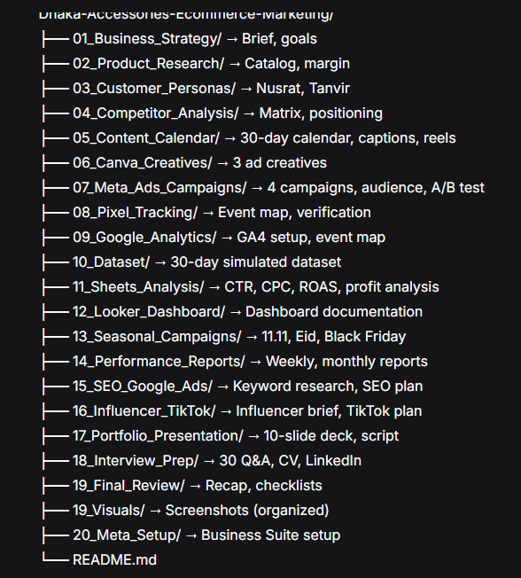

# Dhaka Accessories: A 30-Day E-commerce Digital Marketing Portfolio Project (Bangladesh)

A complete 30-day e-commerce digital marketing project for a **simulated** B2C fashion accessories brand based in Dhaka, Bangladesh.

**⚠️ Disclaimer:** All data in this repository is **simulated** for learning and portfolio purposes. This project does not represent real business performance, real customers, or any real company's data. No real ad spend occurred. This is a portfolio project for a job application — not a commercial work.

---

## Project Overview

This project demonstrates the full workflow of an E-commerce Digital Marketing Executive in Bangladesh:

- Business strategy and planning
- Product research and pricing
- Customer personas and competitor analysis
- Content calendar and copywriting
- Canva creative design
- Meta Business Suite and Meta Ads Manager planning
- Audience targeting and A/B testing
- Facebook Pixel and GA4 measurement
- Dataset creation and Google Sheets analysis
- Looker Studio dashboard
- Weekly and monthly reporting
- Seasonal campaigns (11.11, Eid, Black Friday)
- Google Ads and SEO fundamentals
- Influencer and TikTok marketing
- Portfolio presentation and interview preparation

Built over 30 days, one day at a time.

---

## Business Problem

Dhaka Accessories is a fictional B2C fashion accessories brand in Dhaka selling jewelry, bags, and hair accessories. The challenge:

- Brand new, limited monthly budget (15,000 BDT)
- Cash on delivery dominates (86.8% of Bangladeshi online shoppers)
- Fashion is the #1 online category in Bangladesh (70.3%)
- Dhaka has the highest online shopping participation (21.3%)
- Target demographic: 25–34 age group (24.7% of shoppers)

*Source: BBS 2024-25 public data.*

---

## Objectives

1. Build a complete marketing strategy for a small B2C brand
2. Practice Meta Ads campaign structure and audience planning
3. Build a measurement plan using Meta Pixel and GA4
4. Create a realistic dataset and analyze it
5. Build a recruiter-ready dashboard
6. Write performance reports and business recommendations
7. Present the project as a portfolio

---

## Folder Structure

